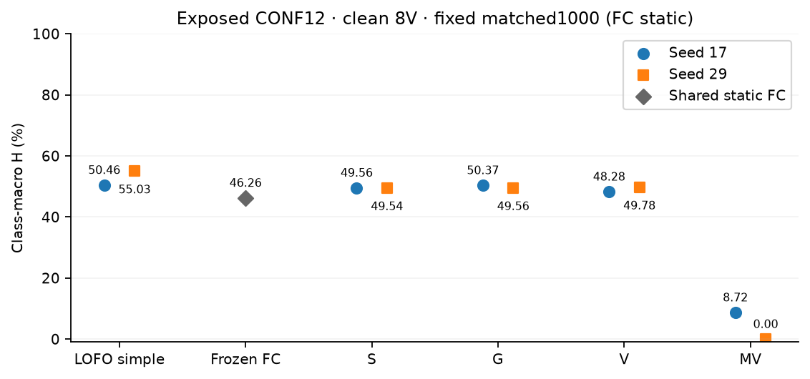
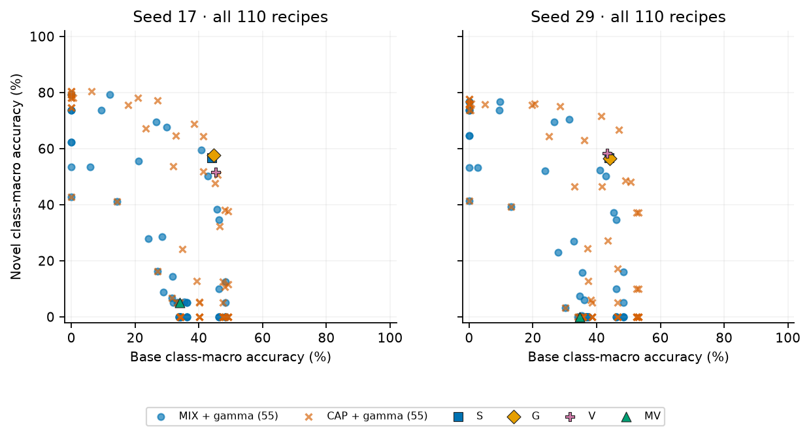
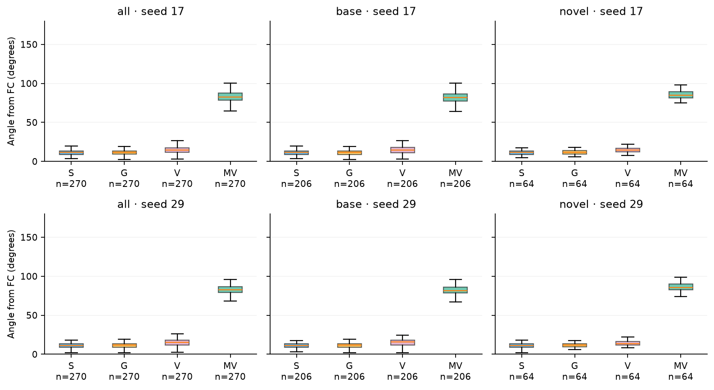
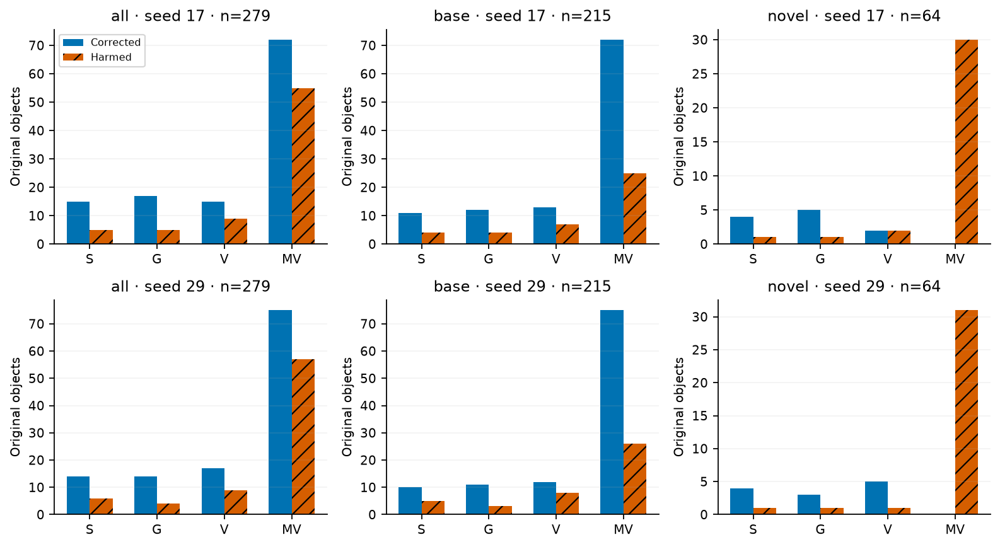

# Semantic update evidence v1

状态：COMPLETE_A_NO_RESIDUAL_SIGNAL。A真实诊断完成；B/C为NOT_ACTIVATED_BY_A。279原件、215旧base/64旧novel、12家族；270有支持，9个abstention保留且计错。没有缺失原NPZ，不需要重建缓存或补GPU推理。

强简单对照先于复杂方法列出。主表均为clean、8V；S/G/V/MV固定matched1000，FC是同prefix原静态selected列，仅计一次。LOFO每折用另11家族seed17选参，再把同一recipe用于留出家族两个seed，拼回原件后重新按类计算。

|方法|seed|B_macro %|N_macro %|H_macro %|H_micro %|
|---|---:|---:|---:|---:|---:|
|LOFO_SIMPLE|17|41.46|64.44|50.46|54.21|
|LOFO_SIMPLE|29|46.87|66.64|55.03|58.94|
|B_FC|静态一次|42.88|50.23|46.26|38.27|
|S_LL|17|43.98|56.77|49.56|42.11|
|S_LL|29|43.94|56.77|49.54|41.43|
|G_LL|17|44.66|57.77|50.37|42.94|
|G_LL|29|44.19|56.42|49.56|41.94|
|V_LL|17|45.28|51.70|48.28|40.24|
|V_LL|29|43.37|58.42|49.78|41.54|
|MV_ATTN|17|34.00|5.00|8.72|3.04|
|MV_ATTN|29|34.64|0.00|0.00|0.00|

|方法|seed|ΔH_macro vs LOFO (pp)|正增益家族/可定义家族|B门槛|
|---|---:|---:|---:|---|
|S_LL|17|-0.89|4/12|未通过|
|S_LL|29|-5.49|1/12|未通过|
|G_LL|17|-0.08|5/12|未通过|
|G_LL|29|-5.47|1/12|未通过|

B仅在S或G两个seed都ΔH_macro≥1pp、且各≥8个可定义家族正增益时开启。当前均未满足，reference=null。门槛是预定资源政策；不是统计显著性或CVPR接收标准，也不能推断所有S/G差异都已被校准解释。

旧CONF12已曝光，LOFO也仍是探索性诊断。这里没有独立新确认、没有新152/8/40训练，也没有重跑OVI-MAP或全地图AP；不把本表H_macro当原论文AP或系统优越性证明。H_micro由组内普通准确率算；H_macro先按正样本类平均，两者分列。

## Novel错误分解

以下为200类正式竞争和novel-only辅助诊断的差异；novel内部正确但被base等竞争抑制，是描述性计数，不是已识别因果机制。主表有正样本的支持类别为59个旧base和20个旧novel；没有正样本的类别不填0，也不改变200类竞争词表。

|方法|seed|novel原件|novel内部Top1正确|内部正确但被全词表竞争压制|novel内部错误|全词表Top1为base|
|---|---:|---:|---:|---:|---:|---:|
|S_LL|17|64|51|17|13|29|
|S_LL|29|64|52|18|12|29|
|G_LL|17|64|52|17|12|28|
|G_LL|29|64|51|18|13|30|
|V_LL|17|64|51|20|13|30|
|V_LL|29|64|51|16|13|27|
|MV_ATTN|17|64|23|22|41|63|
|MV_ATTN|29|64|23|23|41|63|

## 留一家族选参锁

|留出家族|seed17选定、双seed沿用的recipe|原件数|
|---|---|---:|
|scene0108|`CAP|10|+0.025`|34|
|scene0109|`CAP|10|+0.025`|19|
|scene0158|`CAP|10|+0.025`|33|
|scene0182|`CAP|10|+0.025`|16|
|scene0199|`CAP|10|+0.025`|16|
|scene0410|`CAP|10|+0.025`|22|
|scene0444|`CAP|10|+0.025`|11|
|scene0447|`CAP|10|+0.025`|26|
|scene0456|`CAP|10|+0.025`|22|
|scene0460|`CAP|10|+0.025`|20|
|scene0501|`CAP|10|+0.025`|38|
|scene0628|`CAP|10|+0.025`|22|

110逻辑候选是55 MIX_GAMMA加55 CAP_GAMMA，不做三重笛卡尔积。gamma使用原余弦单位，MIX不归一化分数。CAP直接读取真实768维单位向量并用原FP32文本重算；未反演embedding。FP64只用于角度几何，裁剪向量回FP32；文本没有再次归一化。原cosine重构最大绝对误差为4.172325134277344e-07.

exact_score_alias和exact_prediction_alias分别核对实际数组；相同准确率不构成alias。所有110候选、12折训练候选指标、OOF原件预测、正误路径、全体/base/novel角度、各家族类支持和selected 2/4/8V四条件辅助指标随工件公开。两个seed各自计算，不拼成558个独立对象。

## 条件阶段与资源

|阶段/产物|状态|实测新工作|
|---|---|---:|
|A 导入、排名、110候选、LOFO、决策|COMPLETE|279原NPZ、220组CPU候选预测、10次CPU CAP文本矩阵评分|
|B 角色、数值接入、三臂训练、RAW/POST锁|NOT_ACTIVATED_BY_A|0更新、0head、0字典phi/Gram、0solver迭代|
|B REG26 14槽两融合、成本表|NOT_ACTIVATED_BY_A|0新评分/计时；结果null|
|C 提名、获取、12seed×32mask、REAL/GT预测|NOT_ACTIVATED_BY_A|0下载、0FC/SAM图、0head|
|C 4×1000 bootstrap、最多8张真实案例|NOT_ACTIVATED_BY_A|0抽样集合、0案例|

没有新训练模型或30个checkpoint可交付；未训练模型定义和CPU算子测试不是B真实接入证据。所有B/C公开phase均记录未激活，不能把它们标为运行成功。新地图、N/Q编码、旧RGB编码、GPU模型加载均0；CPU数组操作非零，详见workload.json。实际科学子进程exit=0由外层观察，最终发布后resume另行实测，不预写零工作结论。

## 图表与边界

来源是旧160类监督方案，原novel40已被此前确认观察；新CORE152/PSEUDO8/FINAL40协议本轮没有开启。没有C/REAL/REG新表，也没有系统30FPS、显存或冷启动实测。该结果支持保留简单校准作为强对照，当前没有继续投入E机制新训练的预定残差信号。

主审修复公开后备key连接、显式defined屏障，以及cached bind丢失既有消费身份的问题；修复后换producer identity复算。此前候选与OOF数组已保存并逐位核对。3次A累计660组CPU候选预测、30次CPU CAP文本评分、837次原NPZ读取；GPU head始终0。四组最终12项测试通过；初次全组收集遇到控制环境缺timm，T2/T3在既有FC环境运行，T1/T4在控制环境完成。后续仅重跑受影响T1或T4。
